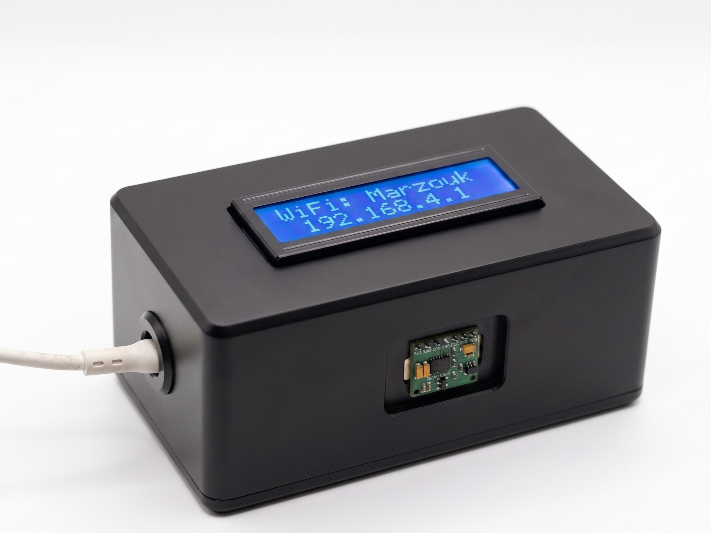
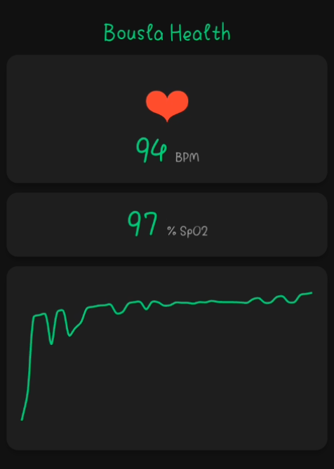

# Heart Rate and Oxygen Level Monitor 

## About The Project 
This project is a smart health device. It checks two important things in your body:
1. **Heart Rate (BPM):** How fast your heart beats.
2. **Oxygen Level (SpO2):** How much oxygen is in your blood.

The device has a small screen to show the numbers. It also creates its own WiFi. You can connect your phone to this WiFi to see a live graph of your heartbeat.

### Project Pictures 
*Here is how the final device looks:*

*Here is the device working and showing numbers on the screen:*

*Here is the live web page on the phone:*

## How It Works 
When you put your finger on the sensor, it uses a red light to read your pulse. The main brain of the device (ESP32) takes this reading. Then, it sends the reading to the screen (LCD) and the web page at the same time.

## Hardware Used 
* **ESP32:** The small computer chip that runs the code and makes the WiFi.
* **MAX30102:** The sensor that reads the finger.
* **16x2 LCD:** The small screen on the box.

## How to Use It 
1. Give power to the device (plug in the cable).
2. Look at the screen. It will show a WiFi name: `Marzouk`.
3. Connect your phone to this WiFi. The password is `12345678`.
4. Open your web browser (like Chrome) and go to `http://192.168.4.1`.
5. Put your finger gently on the red sensor. 
6. See your health numbers on the screen and the phone.
